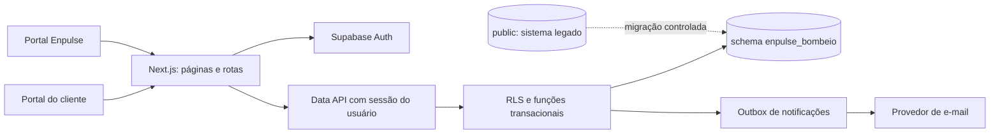
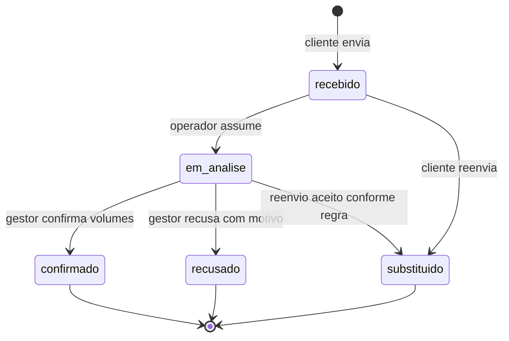

# Plataforma de bombeio Enpulse — plano técnico e lógico

**Estado:** proposta de arquitetura e execução, 18/11/2026. **Projeto Supabase usado na criação:** `pedido-bombeio` (`qzrwgxxltwzlkszozoca`). **Novo schema:** `enpulse_bombeio`, criado e verificado privado. **Atenção operacional:** uma verificação posterior encontrou o projeto indisponível pela Management API e pelo DNS; confirmar seu estado antes de nova migração. As demais estruturas descritas aqui ainda são alvo de implementação.

## 1. Resultado esperado e situação atual

A plataforma terá dois portais sobre o mesmo pedido: o **cliente** solicita e acompanha volumes; a **Enpulse** recebe, prioriza, analisa, confirma e audita. Os dois lados consultam o mesmo registro de negócio, com permissões diferentes e sem cópias divergentes da verdade.

Hoje há um formulário Next.js 15 com CNPJ e seis quantidades, uma rota `POST /api/pedidos` que usa chave privilegiada, e `public.pedidos_bombeio`/`public.config_bombeio`. O banco marca data e prazo por trigger. O CNPJ ainda não representa identidade verificada, não há portal interno e o modelo atual mistura volume recebido com andamento operacional. O layout Enpulse implementado na página inicial é o ponto de partida visual, não o modelo final da plataforma.

### Objetivos de negócio

1. Cliente autorizado consegue solicitar, revisar, receber protocolo e acompanhar seu pedido sem ver dados de outra empresa.
2. Operação Enpulse vê a fila do dia, identifica atrasos e reenvios, acompanha totais por produto, registra análise, confirma volumes e comunica resultados.
3. Toda mudança relevante tem ator, data, motivo e histórico; reenvios e confirmações preservam o que o cliente pediu originalmente.
4. Prazo, fuso e regras da base são aplicados no servidor e ficam registrados no pedido para que uma alteração futura da configuração não reescreva o passado.

### Limites desta iniciativa

O primeiro lançamento cobre Base Paulínia e GAS A, S500 A e S10 A. Outras bases/produtos entram pelo catálogo sem mudar a identidade dos pedidos anteriores. Integração automática com ERP/PETROW, otimização logística e faturamento ficam para uma etapa posterior após contrato de dados próprio.

## 2. Jornada e navegação

### Portal do cliente

| Tela | Conteúdo e ação principal | Estados importantes |
| --- | --- | --- |
| Acesso | E-mail autorizado, código de uso único, vínculo ao cliente | código enviado, expirado, limite de tentativas, acesso suspenso |
| Início | Próximo corte, base, pedido de hoje e histórico recente | sem pedido, pedido em análise, confirmação disponível |
| Novo pedido | Produtos em cartões, bombeio e previsão D+1, resumo fixo | entrada inválida, rascunho local, após o corte |
| Revisão | CNPJ/cliente, data, seis volumes, prazo e confirmação explícita | envio em andamento, repetição protegida por idempotência |
| Comprovante | Protocolo, horário oficial, itens e situação do prazo | impressão/cópia, falha de notificação sem perder pedido |
| Detalhe/histórico | Linha do tempo, solicitado versus confirmado, reenvios | ajuste pendente de ciência/aprovação, se esta regra for adotada |

O CNPJ vem do vínculo da sessão; aparece para conferência e não é editável no envio. Um usuário vinculado a mais de um cliente escolhe o contexto antes de entrar no pedido. O navegador guarda apenas rascunho não sensível durante a sessão; ao expirar, preserva os valores para retomada após novo login sem transmiti-los a outro cliente.

### Portal da Enpulse

| Tela | Conteúdo e ação principal | Estados importantes |
| --- | --- | --- |
| Visão do dia | Data/base, cartões de pedidos recebidos, pendentes, após corte e confirmados; totais por produto | atualização, atraso, dados incompletos |
| Fila de pedidos | Tabela com protocolo, cliente, hora, status, prazo e totais; busca e filtros | reenvio, duplicidade, pedido atribuído a outro operador |
| Detalhe | Solicitado versus confirmado por produto, previsão D+1, histórico e comentários operacionais | conflito de edição, ajuste com motivo obrigatório |
| Ações | Assumir análise, propor ajuste, confirmar ou recusar conforme papel | confirmação atômica, versão desatualizada |
| Relatórios | Exportação filtrada e totais do período com data/fuso/unidade explícitos | exportação auditada, limite de volume |
| Administração | Clientes, usuários autorizados, papéis, produtos, bases e regras de corte futuras | dupla conferência para regras operacionais |

A tela principal é uma **fila operacional**, não um painel de gráficos decorativos. Cada indicador abre a lista filtrada que o explica. Uma seleção de dia ou base altera indicadores e tabela juntos. Atualização por polling curto ou evento em tempo real é uma otimização posterior; a primeira versão inclui botão e carimbo de última atualização.

## 3. Arquitetura e responsabilidades

| Dono da regra | Responsabilidade única |
| --- | --- |
| Supabase Auth | Verificar identidade e manter sessão; código de e-mail não é tabela de negócio |
| Tabelas de vínculo e RLS | Determinar cliente e papel efetivo em cada leitura/escrita |
| Banco `enpulse_bombeio` | Prazo oficial, estados, integridade, idempotência e auditoria transacional |
| Rotas Next.js | Orquestrar casos de uso, validar formato/entrada, traduzir erros e checar sessão |
| Interface | Tornar decisão, valores e próximos passos compreensíveis e acessíveis |
| Trabalhador de notificações | Entregar mensagens a partir de outbox, com repetição segura |

O schema `enpulse_bombeio` começa **fora dos schemas expostos**. Uma fatia posterior habilita a Data API somente após grants mínimos, RLS e testes de isolamento. Rotas de pedido usam cliente Supabase associado à sessão do usuário; `service_role` fica restrito a tarefas administrativas e migrações. Para operações compostas, funções transacionais verificam identidade, papel e versão esperada, com `search_path` fixo e permissão de execução específica.

**Organização de código proposta:** rotas e layouts separados para `cliente` e `operacao`; casos de uso de pedido, identidade e confirmação em módulos de domínio com interfaces pequenas; adaptadores Supabase e e-mail na borda; componentes visuais compartilhados sem lógica de permissão. Os contratos HTTP e do banco derivam das especificações SDD. Um teste de regra não precisa montar a página; um teste de permissão exercita o banco com a identidade real do perfil.

## 4. Identidade, papéis e autorização

**Cliente:** e-mail previamente cadastrado, OTP de seis dígitos e `shouldCreateUser: false`; criação e vínculo de usuário são ações administrativas. Respostas de solicitação de código não revelam cadastro. OTP expira, tem limite de envio e tentativas. A sessão usa cookies protegidos no fluxo SSR/PKCE, renovação controlada e saída explícita.

**Enpulse:** acesso individual com papel efetivo em tabela controlada pela operação. O método de entrada está **indefinido pelo negócio**: convite por e-mail com MFA ou SSO corporativo. A escolha não muda os vínculos de autorização. A exigência de MFA para ações sensíveis será confirmada junto com o provedor escolhido.

| Operação | Cliente | Leitura Enpulse | Operador | Gestor | Administrador |
| --- | --- | --- | --- | --- | --- |
| Ver pedidos | Apenas próprios | Todos da base autorizada | Todos da base autorizada | Todos | Todos |
| Enviar/reenvio | Próprios | — | — | — | — |
| Assumir/analisar | — | — | Sim | Sim | Sim |
| Propor ajuste | — | — | Sim | Sim | Sim |
| Confirmar/recusar | — | — | — | Sim | Sim |
| Exportar | — | Escopo autorizado | Escopo autorizado | Todos | Todos |
| Gerir usuários/regras | — | — | — | Regras operacionais aprovadas | Sim |

O servidor não recebe `cliente_id` ou CNPJ do corpo como prova de permissão. Ele deriva o cliente dos vínculos ativos de `auth.uid()`. Toda consulta filtra por papel e base; RLS protege o mesmo limite se uma rota errar. `user_metadata` editável pelo usuário não determina papéis.

## 5. Modelo lógico no novo schema

| Entidade | Campos essenciais | Invariantes |
| --- | --- | --- |
| `bases` | id, código, nome, fuso, ativo | base de um pedido não muda após envio |
| `clientes` | id, CNPJ normalizado único, nome, ativo | CNPJ identifica empresa, não sessão |
| `usuarios_cliente` | user_id, cliente_id, ativo, papel | vínculo explícito e revogável; pode haver vários usuários |
| `usuarios_enpulse` + `acessos_base` | user_id, papel, base_id, ativo | papel e escopo vêm de cadastro controlado |
| `produtos` | código, nome, unidade, ordem, ativo | itens antigos preservam descrição/unidade aplicadas |
| `regras_operacionais` | base, vigência, corte, alvo de confirmação, fuso | vigência não se sobrepõe; pedido guarda snapshot |
| `pedidos` | id, protocolo, cliente, base, data operacional, status, enviado_em, prazo, regra aplicada, autor, versão, idempotência, hash do payload, pedido substituído | enviado é imutável; reenvio cria outro pedido |
| `pedido_itens` | pedido, produto, bombeio solicitado, venda D+1, bombeio proposto/confirmado, motivo | valores ≥ 0 e até 3 casas; solicitado não muda na análise |
| `pedido_eventos` | pedido, tipo, ator, instante, dados mínimos | append-only; toda transição tem evento |
| `notificacoes_outbox` | evento, destino, modelo, estado, tentativas, próximo envio | falha de e-mail não desfaz pedido |
| `migracao_legado` | origem, id antigo, id novo, importado_em | importação idempotente e rastreável |

Índices iniciais: `(base_id, data_operacional, status, enviado_em)`, `(cliente_id, data_operacional desc)`, unicidade de `(autor, chave_idempotencia)`, unicidade de vínculo `(user_id, cliente_id)` e de `(pedido_id, produto_id)`. Índices e planos de consulta serão medidos com dados representativos antes de ampliar a operação.

### Regras de domínio

- `enviado_em` vem do banco. `data_operacional`, `corte_aplicado`, `fuso_aplicado` e `dentro_prazo` são calculados uma vez no servidor/banco e guardados no pedido.
- Campos vazios de volume equivalem a zero no envio; formato inválido, negativo, acima do limite ou todos zerados são rejeitados. O limite é configurado por produto/regra, não apenas pelo JavaScript do navegador.
- O protocolo é estável e único. A repetição da mesma tentativa com a mesma chave de idempotência devolve o mesmo pedido; um reenvio intencional tem outra chave e aponta para o pedido anterior.
- O pedido original e seus itens solicitados são imutáveis após envio. A Enpulse registra `volume_confirmado` e motivo de ajuste separadamente. Histórico e exportação distinguem solicitado, confirmado e previsão.
- Para a visão operacional do dia, o pedido vigente por cliente/base/data é o último reenvio válido; versões anteriores continuam consultáveis e auditadas.

### Estados do pedido

Ajuste de volume é dado da análise, não um estado vago. A necessidade de **aprovação do cliente antes da confirmação de um ajuste** é uma decisão pendente; se exigida, incluir `aguardando_cliente` e sua transição em especificação própria antes de implementar confirmação. Concorrência: toda transição exige `versao_esperada`; conflito responde com estado atual e não grava metade da operação.

## 6. Contratos de aplicação

Rotas propostas sob `/api/v1` (a rota legada continua até o corte):

| Rota | Ator | Resultado |
| --- | --- | --- |
| `GET /me` | autenticado | identidade, clientes/bases autorizados e papel |
| `GET /operacao/regras-atuais` | cliente ou integrante | base, data, corte e fuso aplicáveis |
| `POST /pedidos` | usuário do cliente | pedido/protocolo, com `Idempotency-Key` |
| `GET /pedidos` e `GET /pedidos/:id` | ambos | lista/detalhe no escopo permitido |
| `POST /pedidos/:id/reenvios` | usuário do cliente | novo pedido relacionado ao anterior |
| `POST /pedidos/:id/assumir` | operador+ | transição e versão atualizadas |
| `POST /pedidos/:id/confirmar` | gestor+ | volumes confirmados, motivo e evento atômicos |
| `POST /pedidos/:id/recusar` | gestor+ | motivo e evento atômicos |
| `GET /operacao/resumo` | integrante | métricas da mesma consulta/filtro da fila |
| `GET /operacao/exportacoes` | papel permitido | exportação auditada e limitada |

Todos os contratos incluem `request_id`, erro estável (`codigo`, `mensagem`, `campos` quando aplicável), paginação por cursor para filas grandes e data/hora ISO com fuso explícito. Nunca retornar chave, token, código OTP ou dados de outro cliente. `401` exige autenticação; `403` indica papel insuficiente; `409` identifica versão/conflito ou idempotência incompatível; `422` identifica valores inválidos; `429` indica limite de tentativas.

## 7. Segurança, confiabilidade e operação

- RLS em todas as tabelas expostas; grants explícitos por operação; testes negativos entre dois clientes, perfil anônimo e papel de leitura. Visões devem obedecer RLS (`security_invoker`) ou permanecer privadas.
- Cookies de sessão com escopo seguro, respostas autenticadas sem cache compartilhado, proteção CSRF/Origin em mutações, limites por conta e origem. Segredos em cofre/variáveis de ambiente e revisão de acesso individual; sem login compartilhado.
- Log estruturado com `request_id`, protocolo, evento e resultado; CNPJ parcialmente mascarado. Nenhum log contém OTP, tokens, cabeçalhos de autorização ou payload integral de pedido.
- Outbox transacional para confirmação e mudança de status; trabalhador idempotente com tentativas e fila de falha. Falha do provedor de e-mail fica visível para suporte e não altera a verdade do pedido.
- Rotina diária de reconciliação: pedidos sem evento, confirmações sem notificação, reenvios vigentes e diferenças entre resumo e fila. Backups e recuperação são verificados antes do corte de produção.
- Metas iniciais para validar com a equipe: envio em até 2 minutos no celular após login; p95 da fila abaixo de 2 s no volume esperado; zero acesso cruzado; 100% das transições com evento e autor.

## 8. Migração sem perda de histórico

1. **Preparar:** confirmar/restabelecer o projeto remoto e verificar novamente o schema privado criado; registrar snapshot de contagem, chaves e estados em `public`, sem alterar o fluxo atual.
2. **Expandir:** criar tabelas, funções, grants, RLS e dados de catálogo por migrações incrementais. Exercitar em base de teste com dados sintéticos; só depois habilitar a exposição do schema.
3. **Importar:** mapear CNPJ legado para cliente; CNPJ desconhecido vira cadastro inativo para reconciliação. Importar cada pedido e seus seis valores com vínculo ao id original, horário e indicador de prazo preservados. Validar totais e amostras por dia/produto.
4. **Corte:** habilitar novo portal e rota, bloquear novas escritas na rota legada somente no instante da troca; importar delta final; conferir contagens. Manter `public` disponível para consulta e reversão, sem apagar tabelas.
5. **Estabilizar:** acompanhar erros, acesso, fila, confirmações e reconciliação por período acordado. Reverter tráfego para rota anterior se falha crítica, preservando pedidos criados no novo schema para reconciliação antes de nova tentativa.

O plano de migração requer uma janela e responsável operacional. Não executar exclusões nem reescrever pedidos antigos no primeiro corte.

## 9. Entrega por etapas

| Etapa | Demonstração de ponta a ponta | Gate para avançar |
| --- | --- | --- |
| 0. Fundação | projeto Supabase acessível, namespace, especificações, design system e CI | migrações repetíveis; decisões críticas registradas |
| 1. Identidade | cliente A entra e cliente B não vê seu pedido; integrante entra no portal próprio | matriz RLS e sessão testadas |
| 2. Pedido | cliente envia, recebe protocolo, consulta histórico e reenvia intencionalmente | prazo, idempotência e imutabilidade comprovados |
| 3. Operação | fila do dia e detalhe mostram os mesmos totais; operador assume e gestor confirma | conflito, auditoria e papéis comprovados |
| 4. Comunicação | cliente vê confirmação; e-mail é entregue ou fica recuperável na outbox | falhas e repetição testadas |
| 5. Migração/corte | histórico `public` aparece no novo portal sem perda | reconciliação, backup e reversão aprovados |

Tickets verticais e dependências estão em `.scratch/enpulse-plataforma/issues/`; decisões abertas no [mapa local](../../.scratch/enpulse-plataforma-wayfinder/map.md).

## 10. Decisões que exigem dono de negócio

1. Método de entrada dos integrantes: SSO corporativo ou convite individual com OTP/MFA. O vínculo de papéis no banco permanece o mesmo.
2. Ajuste de volume: confirmação direta pela Enpulse com aviso, ou aprovação do cliente antes de concluir. O estado `aguardando_cliente` depende dessa resposta.
3. Reenvio após a Enpulse começar análise: permitido até quando, e quem decide qual versão vale?
4. Quem pode confirmar/recusar, quais motivos são obrigatórios, e qual o SLA real de confirmação por base?
5. Período de retenção, destinatários de notificações e regras de exportação de dados.

Enquanto essas decisões não forem fechadas, as especificações marcam suposições e as fatias dependentes não entram em produção.

## Fontes técnicas consultadas

- [Supabase: schemas personalizados](https://supabase.com/docs/guides/api/using-custom-schemas)
- [Supabase: RLS e grants](https://supabase.com/docs/guides/database/postgres/row-level-security)
- [Supabase: proteção da Data API](https://supabase.com/docs/guides/api/securing-your-api)
- [Supabase: login por OTP](https://supabase.com/docs/guides/auth/auth-email-passwordless)
- [Supabase: sessões SSR no Next.js](https://supabase.com/docs/guides/auth/server-side/creating-a-client?framework=nextjs)
- [Supabase: migrações locais](https://supabase.com/docs/guides/local-development/database-migrations)
