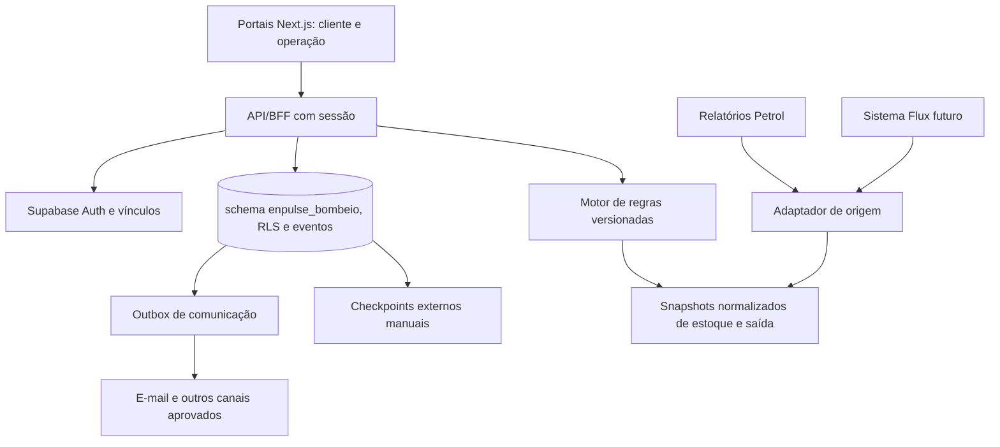

# Plataforma de bombeio Enpulse — revisão da reunião e plano de frontend

**Base:** [transcrição da reunião de 17/11/2026](https://docs.google.com/document/d/1D7Y7LAJoVii6NzR6YowkFJbHaNoMRBqy1QWk03JxSp0/edit), contexto desta conversa e estado do repositório em 18/11/2026. A transcrição foi gerada automaticamente e pode ter erros de nomes e números. Este documento orienta o produto completo; a **primeira entrega proposta é somente frontend navegável com dados simulados**. Nenhuma tela simulada deve representar envio, confirmação ou integração real em produção.

## 1. O que a conversa estabeleceu

| Tema | Evidência da reunião | Implicação para o produto |
| --- | --- | --- |
| Entrada | Cerca de 25 distribuidoras enviam pedidos por WhatsApp ou e-mail; não há canal padrão (10–12 min). | Portal de cliente autenticado, cadastro de distribuidoras e rastreio de autor. |
| Pedido | Cliente informa volume por produto para D+1 e pode informar previsão de saída excepcional; produtos: Gasolina A, S10 A e S500 A (34–37 min). | O formulário distingue quantidade solicitada, previsão informada e ausência de previsão. |
| Prazo | Envio até 12h. Caio sugeriu abrir às 9h e depois citou 8h no dia seguinte (29–30 min). | Janela configurável; 8h versus 9h exige decisão. Fora da janela, a interface bloqueia novo envio e mostra a próxima abertura. |
| Sexta-feira | Programação pode abranger sábado, domingo e segunda; a operação escolhe um, dois ou três bombeios (30–32 min). | Uma programação possui datas alvo e quantidade de bombeios. A tela de sexta não pode ser apenas o formulário diário repetido. |
| Análise | Considera saldo atual, saída média, dias de estoque, pedido e exceções por distribuidora e produto (20–28 min). Espaço em tanque é contexto, não regra única de aprovação (28–30 min). | Bancada de análise por item com fontes, cálculos explicáveis, proposta e decisão humana. |
| Exceções | Venda/saída extraordinária justificada pode mudar o corte sugerido (25–27 min). | Campo de justificativa e evidência, alerta de exceção, override humano auditável. |
| Retorno | A Enpulse confirma ou ajusta o volume ao cliente por e-mail/WhatsApp; o cliente entra no Canal Cliente Petrobras até 15h e a base confirma até 15h30 (16–19 min). | Linha do tempo separa decisão interna, devolutiva, ação externa do cliente e confirmação da base. |
| Automação | Primeiro pacote: pedidos, análise e devolutiva. Integração com Petrobras, documento D3 e alimentação do novo sistema ficam depois (32–35 min). | Frontend contempla checkpoints manuais, sem sugerir que exista API ou aprovação automática. |
| Dados | Petrol atual pode ser substituído por Flux; acesso aos relatórios por login/automação foi discutido sem contrato definitivo (37–41 min). | Motor de análise recebe dados normalizados por adaptador; a tela mostra origem, horário e qualidade do dado. |
| Segurança | Caio pediu validação do usuário vinculado à distribuidora, pois links podem ser compartilhados (45–47 min). | Acesso verificado e escopo por cliente são requisitos centrais. |

O termo “cliente bom/ruim” foi usado como atalho na demonstração e reconhecido como inadequado. A interface usa métricas observáveis: **dias de estoque, giro, saldo, previsão e divergência**.

## 2. Resultado e limites

O sistema deve receber o pedido de uma distribuidora identificada, calcular uma **recomendação explicável** por data e produto, permitir que um integrante Enpulse revise e altere a proposta, comunicar a decisão ao cliente e registrar os passos externos até o encerramento. A recomendação não envia mensagens nem confirma pedidos sozinha na primeira versão.

O primeiro recorte operacional contempla Base Paulínia, Gasolina A, S10 A e S500 A. A estrutura deve comportar outras bases e produtos via catálogo, sem reescrever pedidos anteriores. O Canal Cliente Petrobras continua externo; a plataforma registra seu andamento manualmente. A origem de dados Petrol/Flux é substituível e não altera as regras do domínio.

### Diferenças frente ao código atual

| No repositório hoje | Requisito levantado | Ação planejada |
| --- | --- | --- |
| Pedido associado ao dia do envio | Solicitação para data D+1, com programação especial na sexta | Separar `dia de envio`, `janela` e `datas alvo` no contrato e na UI. |
| Envio após 12h aceito como tardio | Reunião propôs fechar a janela ao meio-dia | Prototipar bloqueio e próximo horário; validar exceção operacional antes de alterar backend. |
| Previsão vazia vira zero | Previsão pode faltar; nesse caso usa-se saída média na análise | Modelar `não informado` separadamente de `0 m³`. |
| Fila de pedidos e confirmação direta | Revisão de saldos, giro, exceções, proposta e devolutiva | Criar bancada de análise e estados independentes de análise/comunicação. |
| Três produtos em um dia | Sexta pode cobrir até três dias e 1–3 bombeios | Prototipar matriz data × produto e resumo por horizonte. |
| Sem origem de estoque | Dados vêm de relatórios/sistema que mudará de Petrol para Flux | Contrato de snapshot com origem, atualização e estado de indisponibilidade. |

O backend atual da branch `feat/plataforma-enpulse` é uma fundação técnica. Ele **não implementa** esses novos comportamentos. O frontend inicial serve para validar o fluxo com Caio, Rodrigo e o analista antes de evoluir schema e regras.

## 3. Modelo de processo proposto

**Estados separados:** pedido (`rascunho`, `recebido`, `substituido`); análise (`aguardando_dados`, `sugerida`, `em_revisao`, `decidida`); comunicação (`pendente`, `enviada`, `falha`); acompanhamento externo (`não_iniciado`, `informado_pelo_cliente`, `confirmado_pela_base`, `concluido`). Essa separação impede que um único status esconda se a decisão, o e-mail ou a etapa Petrobras falhou. Os nomes finais serão validados com a operação.

### Regras que não podem ficar implícitas

- Quantidades usam unidade canônica **m³** e precisão definida; exemplos em litros aparecem com conversão explícita (`1 m³ = 1.000 L`).
- A previsão de saída informada pelo cliente é **opcional**. Ausente significa que a análise recorrerá à média histórica disponível; zero declarado significa outra coisa.
- O snapshot de saldo/saída guarda origem, instante, período de cálculo, unidade e qualidade. Recomendação com dado ausente ou vencido vira “revisão manual necessária”.
- Dias de cobertura são exibidos como `saldo atual ÷ saída média diária` quando a média é positiva. A fórmula da **quantidade sugerida** e o tratamento de capacidade/justiça não são deduzidos dessa conta; precisam de regra aprovada e versionada.
- Capacidade global do tanque, entradas previstas e volume já programado aparecem como restrições e contexto. A conversa indica analisar o giro por cliente mesmo quando há espaço físico.
- Exceção comercial e alteração pelo analista guardam motivo, autor, data, solicitado, sugerido e decidido. Rascunhos e reenvios não apagam a trilha anterior.
- A sexta-feira informa o horizonte de sábado/domingo/segunda e os bombeios previstos para o ciclo. A interpretação de “1–3 bombeios” por dia ou por horizonte permanece decisão aberta.
- Horários são calculados para `America/Sao_Paulo` no servidor quando houver backend; o frontend mostra fuso, janela, data alvo e contagem regressiva apenas como apresentação.

## 4. Arquitetura técnica completa

**Contratos de domínio a preparar depois da validação visual:**

| Contrato | Campos e responsabilidade |
| --- | --- |
| `Programacao` | Base, abertura/fechamento, dia de envio, datas alvo, bombeios planejados, versão da regra. |
| `Pedido` / `PedidoItem` | Cliente, autor, protocolo, data alvo, produto, volume solicitado, previsão opcional, justificativa de exceção, versão/reenvio. |
| `SnapshotOperacional` | Saldo atual, saída média, período, entradas/saídas previstas, capacidade, origem, medido em, atualizado em, qualidade. |
| `Recomendacao` | Quantidade sugerida, parâmetros e versão da regra, dados usados, explicação, alertas e confiança/indisponibilidade. |
| `Decisao` | Quantidade decidida, motivo, operador/gestor, instante, versão esperada e destinatários da devolutiva. |
| `Comunicacao` / `CheckpointExterno` | Canal, entrega/erro/tentativas, confirmação de leitura se disponível; marcos informados manualmente sobre Petrobras. |

O motor deve ter cálculo determinístico e testável; IA pode gerar explicação e apontar anomalias, sempre mostrando os números e a regra aplicada. O adaptador de origem converte Petrol, relatório diário ou Flux para o mesmo `SnapshotOperacional`. Integração de tela no sistema antigo, se necessária, fica isolada nesse adaptador e monitorada por falha/frescor. Nenhum relatório operacional é publicado no GitHub como banco de dados de produção.

Supabase mantém identidade, RLS, persistência e auditoria. A conexão real depende de um novo projeto, que ainda não existe. Vercel hospeda o Next.js; segredos de integração ficam apenas no servidor. A implantação ocorre em ambiente de homologação com dados sintéticos antes do corte. O esquema legado em `public` permanece separado até haver estratégia de migração e reconciliação.

## 5. Plano de experiência e navegação

### Portal do cliente

| Tela | Conteúdo essencial | Estados a desenhar |
| --- | --- | --- |
| Acesso | E-mail pré-cadastrado, OTP, empresa vinculada | código expirado, usuário sem vínculo, bloqueio temporário |
| Início | Próxima janela, data(s) atendida(s), pedido vigente e retorno da Enpulse | janela futura, aberta, encerrada, sexta-feira |
| Novo pedido | Matriz por data e produto, solicitado, previsão de saída opcional, justificativa excepcional | valor ausente/zero, número inválido, rascunho, fonte de data |
| Revisão | Resumo por dia/produto, total, fuso, prazo, declaração do cliente | divergência, pedido duplicado, reenvio intencional |
| Protocolo e histórico | Recebimento, versão vigente, análise, volume decidido, motivo e mensagem | aguardando análise, ajuste, comunicação falha |
| Detalhe de programação | Etapas externas e orientações ao cliente, sem automação Petrobras simulada como real | cliente informou envio, base confirmou, pendente |

### Portal Enpulse

| Tela | Conteúdo essencial | Estados a desenhar |
| --- | --- | --- |
| Visão do ciclo | Janela, dias alvo, pedidos recebidos/ausentes, prazo até 15h/15h30, fonte de dados | segunda a quinta, sexta, atraso, dados velhos |
| Fila | Cliente, produto, data, solicitado, sugestão, divergência, dias de estoque e prioridade | filtro/base/data, reenvio, sem relatório, revisão concluída |
| Bancada de análise | Solicitação versus sugestão versus decisão; saldo, média, projeção, capacidade, exceção e fonte | ajustar, justificar, comparar cenários, conflito de edição |
| Devolutivas | Mensagem por cliente, canal, aprovação humana, envio e falha | rascunho, enviada, reenvio controlado, sem contato |
| Acompanhamento externo | Marcos manuais até 15h/15h30, responsáveis e registro de resultado | prazo próximo, atrasado, concluído, sem confirmação |
| Administração | Distribuidoras, usuários, papéis, bases, produtos, janelas, parâmetros e bombeios de sexta | alteração futura, simulação de regra, trilha de mudanças |
| Relatórios | Pedidos, sugestões, decisões, ajustes, tempo de resposta e exportação | filtro, volume alto, origem de dados incompleta |

### Sistema visual

Evoluir [o design system existente](DESIGN_SYSTEM.md): verde Enpulse como marca e ação; superfícies claras e cinza neutro para dados; alerta âmbar para prazo/dado vencido; vermelho reservado a erro. Na bancada, alinhar números à direita, mostrar unidade em cada coluna e deixar `solicitado`, `sugerido` e `decidido` lado a lado. A foto industrial da referência cabe em acesso e páginas de contexto, longe dos números. O desktop prioriza densidade e comparação; no celular, cliente usa cartões e a operação recebe uma lista de decisão com filtros acessíveis. Testar foco, teclado, contraste, zoom e leitores de tela. Nenhum indicador depende só da cor.

## 6. Primeira entrega: frontend navegável, sem integração real

Criar uma interface de domínio entre páginas e dados (`PlatformGateway`) com implementações `mock` e, depois, `supabase`. Os componentes recebem modelos de apresentação tipados; não consultam tabelas nem conhecem Petrol/Flux. O modo mock usa cenários fixos e relógio controlável, mostra faixa **“Demonstração — dados simulados”** e é proibido no build de produção. Navegação, ações e transições funcionam apenas sobre memória/fixtures. Assim, a Enpulse valida linguagem e processo sem que um botão aparente confirmar um pedido real.

**Organização sugerida:** manter o App Router com grupos separados para `/cliente` e `/operacao`; rotas de detalhe recebem identificadores estáveis. Colocar tipos e casos de uso em `lib/plataforma/`, fixtures versionadas em `lib/plataforma/demo/` e componentes de interface em `app/(platform)/_components/`. Uma fábrica do gateway escolhe a implementação em um único ponto. Páginas recebem dados preparados no servidor ou por uma camada de aplicação; formulários usam estado local apenas até a confirmação da ação. O URL preserva base, ciclo e filtros relevantes para permitir revisão e retorno à fila.

**Contrato de apresentação:** cada página recebe dados, permissões e ações disponíveis explicitamente. Respostas do gateway distinguem sucesso, validação, conflito, falta de permissão e indisponibilidade de dados. O relógio de demonstração, personas e cenários são selecionáveis apenas em ambiente de preview. Os exemplos obrigatórios incluem cliente sem pedido, pedido comum, sexta-feira, reenvio, falta de saldo, dado vencido, exceção comercial, ajuste, falha de devolutiva e prazo externo perdido. Todas as ações simuladas alteram o cenário em memória e exibem seu resultado; recarregar restaura a fixture inicial.

**Contrato com o backend futuro:** autenticação, autorização, janela oficial, cálculos e gravações serão revalidados no servidor. A troca do gateway não pode mudar componentes ou vocabulário. Antes da integração, atualizar `GLOSSARY.md` e as especificações SDD de pedido, reenvio e operação: a definição atual de `data operacional` e `previsão de venda D+1` não expressa bem o horizonte de sexta nem a diferença entre dia de envio e dia atendido. Cada fatia implementada deverá apontar para uma especificação com cenários e evidências, conforme o harness do repositório.

### Fatias verticais propostas (rascunho de tickets, sem publicação externa)

1. **Acesso e visão do ciclo.** Bloqueios: nenhum. Cliente e integrante entram em personas simuladas e veem janela, datas alvo e estado da programação; cobre dia comum, sexta e janela fechada. Aceite: nenhuma persona vê ações ou dados simulados de outra; banner de demonstração sempre visível.
2. **Pedido de dia útil.** Bloqueios: 1. Cliente preenche três produtos para D+1, deixa previsão ausente ou informa exceção, revisa e recebe protocolo simulado. Aceite: ausência difere de zero, unidade e prazo aparecem em todas as etapas, erro preserva campos.
3. **Programação de sexta.** Bloqueios: 1 e 2. Cliente visualiza sábado/domingo/segunda e volumes por data; operação define cenário de 1, 2 ou 3 bombeios. Aceite: resumo identifica exatamente quais datas serão atendidas e como a programação foi composta.
4. **Fila e qualidade dos dados.** Bloqueios: 1 e 2. Integrante filtra pedidos e vê saldo, média, dias de cobertura, origem e atualização; cenário sem dados não gera sugestão. Aceite: contagens e linhas têm o mesmo filtro; reenvio identifica versão vigente.
5. **Bancada de análise.** Bloqueios: 3 e 4. Analista compara pedido, snapshot e sugestão explicável, testa cenário e registra decisão simulada com motivo. Aceite: sugestão nunca confirma sozinha; exceção e override têm autoria e justificativa visíveis.
6. **Devolutiva e acompanhamento.** Bloqueios: 5. Operação revisa mensagem e marca envio simulado, cliente vê retorno, e a linha do tempo inclui marcos Petrobras manuais. Aceite: falha de envio não apaga a decisão; 15h e 15h30 aparecem como prazos distintos.
7. **Administração e relatórios.** Bloqueios: 1 e 4. Gestor simula cadastro, regras futuras, bombeios de sexta, filtros e exportação; sem mutação real. Aceite: alterações de regra mostram impacto antes de “salvar”; relatório separa pedido, sugestão e decisão.
8. **Validação transversal.** Bloqueios: 2–7. Rodar todas as jornadas em 390, 768, 1280 e 1440 px, teclado, zoom e leitores de tela; comparar com Caio, Rodrigo e analista. Aceite: decisões e textos são aprovados antes da integração de dados.

Essas fatias são demonstráveis isoladamente e levam UI, fixtures, estados e verificações juntos. Sem autorização específica, não serão abertas issues no GitHub ou Linear. O plano pode ser refinado após a validação do tamanho e das dependências das fatias.

## 7. Etapas posteriores ao frontend

1. **Contratos e banco:** criar projeto Supabase Enpulse, modelar programação multi-data e snapshots em `enpulse_bombeio`, migrar o código atual por expansão, aplicar RLS e testar cliente A/B e papéis internos.
2. **Dados operacionais:** receber exemplos de relatórios e definir campos, periodicidade, acesso e qualidade; implantar adaptador do sistema disponível sem acoplar o motor ao fornecedor.
3. **Motor de recomendação:** validar fórmula, limites, horizonte e exceções com a operação; versionar parâmetros e resultados, testar cenários históricos anonimizados; iniciar em modo sugestão com decisão humana.
4. **Comunicação e operação:** integrar provedor aprovado, destinatários e tentativas; implementar marcos externos manuais, reconciliação e alertas de prazo.
5. **Piloto e corte:** cadastrar distribuidoras e usuários, homologar ciclos normais e de sexta, confrontar sugestões com decisões humanas, migrar histórico se houver, aprovar responsabilidades, backup e reversão antes da produção.

## 8. Decisões abertas e responsáveis

| Decisão | Dono sugerido | Padrão apenas para o protótipo |
| --- | --- | --- |
| Abertura 8h ou 9h; exceções após 12h | Caio/operador | 8h–12h, configurável, envio bloqueado fora da janela. |
| Sexta: volume e previsão por cada data ou total do horizonte; significado de 1–3 bombeios | Caio/analista | Campos por data e cenário explicitamente marcado como simulação. |
| Fórmula de corte: período da média, piso de estoque, capacidade, prioridade e justiça entre clientes | Caio/analista | Mostrar métricas e sugestão fictícia, sem alegar cálculo oficial. |
| Critério e comprovação de saída excepcional | Caio/atendimento | Justificativa textual e sinalização para revisão humana. |
| Ajuste exige aceite do cliente ou apenas devolutiva? Reenvio é permitido até quando? | Caio/gestão | Mostrar ambas as possibilidades no protótipo, sem fixar transição de produção. |
| Canal, destinatários, modelo e comprovante da devolutiva | Operação Enpulse | Prévia de mensagem e envio simulado. |
| Quais relatórios/campos do Petrol/Flux estarão disponíveis e com que atraso? | Rodrigo/TI Enpulse | Snapshots sintéticos com origem e horário. |
| Papéis, substituto do analista e confirmação dos marcos Petrobras | Gestão Enpulse | Personas cliente, analista e gestor. |

**Gate do frontend:** a equipe deve conseguir percorrer um dia normal, uma sexta com três datas, uma exceção comercial, um dado operacional ausente e um ajuste com comunicação ao cliente, identificando em cada tela o responsável e o próximo passo. Aprovação da interface não equivale a aprovação da regra quantitativa nem à autorização de produção.
